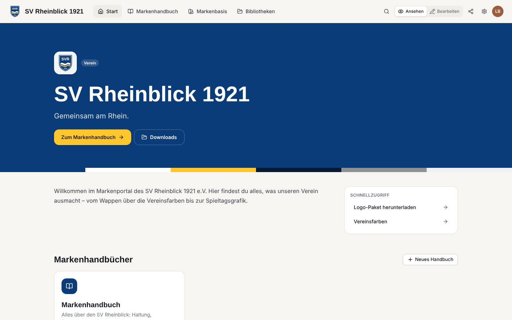
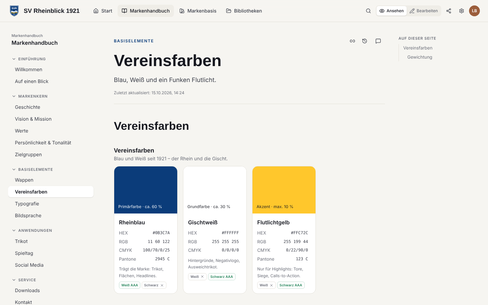
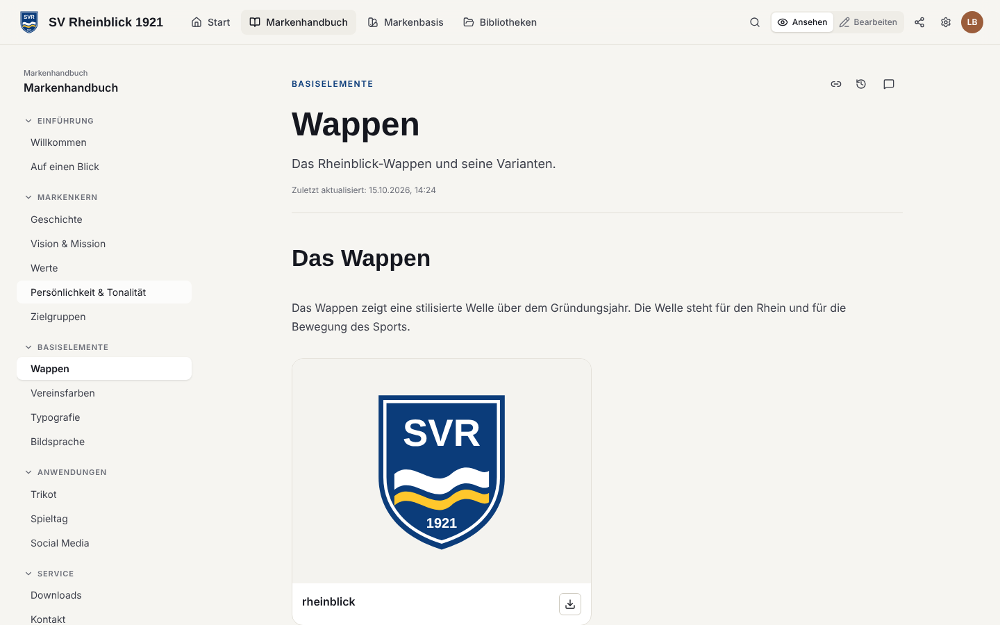
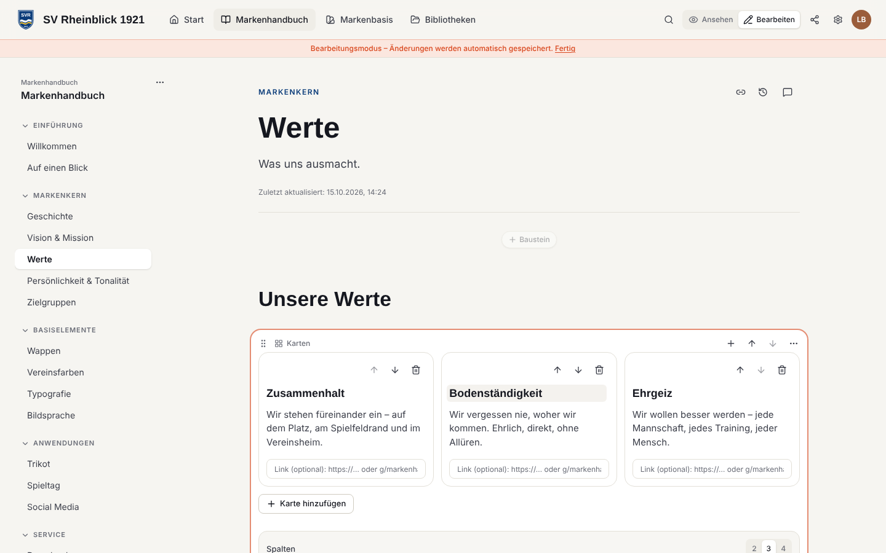
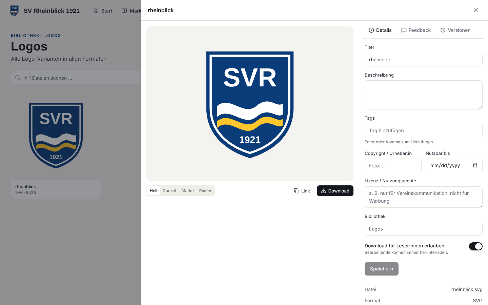
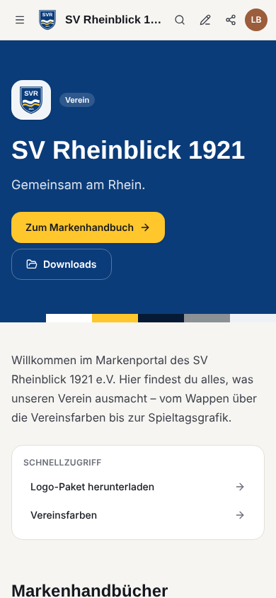

# Markenkompass

**Die ganze Marke an einem Ort, für alle, die mit ihr arbeiten.**

Markenkompass ist ein Brand-Identity-Portal: ein funktionaler Nachbau der Kernfunktionen von [Frontify](https://www.frontify.com), entwickelt für Lehre und kleine Teams. Unternehmen, Vereine, Verbände und Organisationen legen ihre komplette Markenidentität ab:

- Markenkern und Gestaltungsregeln
- Logos, Farben und Typografie
- Bildwelt und Vorlagen

Das Portal ist für beliebig viele Personen zugänglich, mit Rollen und Rechten.

## Funktionen

- **Workspaces und Marken**
  - Ein Workspace (z. B. ein Kurs) enthält beliebig viele Marken.
  - Vorlagen für **Sportverein, Unternehmen/Sportmarke, Verband/Liga, Organisation**, mit Kapitelstruktur und Leitfragen.
  - Dazu ein vollständig ausgefülltes **Demo-Portal** („SV Rheinblick 1921“).
- **Markenhandbuch**
  - Kapitel und Seiten, Bearbeiten direkt auf der Seite (Ansehen/Bearbeiten-Umschalter) mit automatischem Speichern.
  - **22 Bausteine**: Text, Überschrift, Hinweis, Zitat, Farben, Typografie, Logos, Do & Don't, Karten, Bild, Galerie, Video, Audio, Einbettung (Figma, Canva, Miro …), Downloads, Token-Export, Tabelle, Checkliste, Akkordeon, Code, Trenner, Team-Notiz.
  - Bausteine per Drag & Drop sortieren, Breiten 1/1 bis 1/4.
- **Markenbasis**
  - Farbpaletten mit HEX, RGB, CMYK, Pantone, HKS, RAL und NCS, mit WCAG-Kontrastprüfung.
  - Schriften: Web-Font, eigene Dateien oder Systemschrift. Dazu Textstile.
  - Export als CSS, SCSS, JSON (W3C Design Tokens), Tailwind und Adobe ASE.
- **Bibliotheken**
  - Upload per Drag & Drop, Vorschaubilder, Tags, Sammlungen, Suche und Filter.
  - Versionen, Lizenzen und Ablaufdaten.
  - Download mit Umwandlung (PNG/JPG/WebP, auch aus SVG), ZIP-Pakete.
- **Zusammenarbeit**
  - Kommentare an Seiten und Dateien (mit Pins im Bild), Feedback-Übersicht.
  - Änderungsverlauf und Versionen pro Seite.
- **Teilen**
  - Rollen (Admin, Bearbeiten, Ansehen).
  - Einladungen per E-Mail oder Gruppenlink.
  - Öffentlicher Freigabelink mit Ablaufdatum.
- **Export**
  - Ganze Marke als JSON, alle Dateien als ZIP.
  - Handbuch als PDF über die Druckansicht.
- **Mobile-first, Dark Mode, DSGVO-freundlich**
  - EU-Hosting möglich.
  - Schriften über Bunny Fonts, YouTube ohne Cookies.

| Farben                                                       | Logos                                                     | Editor                                            | Asset-Detail                                                              | Mobil                                       |
| ------------------------------------------------------------ | --------------------------------------------------------- | ------------------------------------------------- | ------------------------------------------------------------------------- | ------------------------------------------- |
|  |  |  |  |  |

## Loslegen

| Ich möchte …                                          | Anleitung                                                                    |
| ----------------------------------------------------- | ---------------------------------------------------------------------------- |
| die App online stellen (Supabase + Vercel, kostenlos) | [docs/SETUP.md](docs/SETUP.md)                                               |
| sie in einer Lehrveranstaltung einsetzen              | [docs/LEHRE.md](docs/LEHRE.md)                                               |
| lokal entwickeln, testen, erweitern                   | [docs/ENTWICKLUNG.md](docs/ENTWICKLUNG.md)                                   |
| wissen, was von Frontify übernommen wurde             | [docs/FRONTIFY-VERGLEICH.md](docs/FRONTIFY-VERGLEICH.md)                     |
| die Reverse-Engineering-Analyse lesen                 | [docs/REVERSE-ENGINEERING-FRONTIFY.md](docs/REVERSE-ENGINEERING-FRONTIFY.md) |

## Technik

React 19 · TypeScript · Vite · Tailwind CSS 4 · TanStack Query · TipTap · Supabase (Postgres mit Row Level Security, Auth, Storage)

Getestet mit Vitest (Logik und Datenbankrechte) und Playwright (Mehrnutzer-Ablauf, Mobilansicht).

## Hinweis

Markenkompass ist ein unabhängiges Lern- und Lehrprojekt und steht in keiner Verbindung zur Frontify AG. Es wurden weder Code noch Gestaltung übernommen, nur öffentlich dokumentierte Funktionsprinzipien analysiert. „Frontify“ ist eine Marke der Frontify AG.
